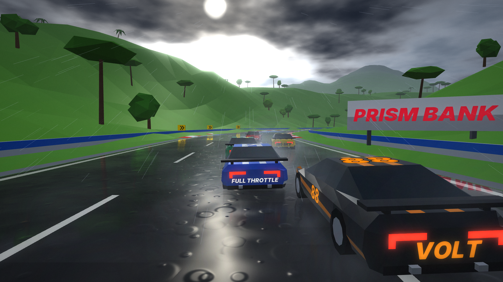

# Full Throttle

A rainy, low-poly stock-car racer for Android, built for the Retroid Pocket 5.

This first build is a **look test**: one rainy circuit, 8 cars, 3 laps. It includes wet-road reflections, tyre spray, rain streaks, lightning, bloom and procedural engine/rain sound. There's no music.



## Install

1. On the Retroid, open the [latest release](../../releases/tag/latest) and download `fullthrottle_v1.apk`.
2. Open the file and allow installs from your browser/file manager if Android asks.
3. Every build is signed with the same key, so new versions install over the old one without losing anything.

The app is about 1 MB of code plus a 260 KB font; there are no big assets. The manifest allows moving it to the SD card (`installLocation="auto"`) where the system supports that.

### ES-DE

`media/boxart.png` is a 2:3 cover for the Android system's box-art slot.

## Controls

| Action | Buttons |
| --- | --- |
| Accelerate | R2 (analog) or R1 |
| Brake / reverse | L2 (analog) or D-pad down |
| Steer | Left stick or D-pad |
| Drift | L1 or B (also: brake + hard steer at speed) |
| Boost | A, X or Y (meter fills while drifting and at speed) |
| Pause | Start (or Back) |
| Restart race | Select |
| Start / race again | A |

## Building

- **APK:** every push to `main` builds through GitHub Actions and updates the `latest` release.
- **Preview video:** `desktop/preview.cpp` runs the same game code headless on Mesa and renders the attract-mode race to video:

```
g++ -O2 -std=c++17 -Idesktop -DASSET_DIR="\"$PWD/app/src/main/assets\"" desktop/preview.cpp app/src/main/cpp/core/*.cpp -o preview -l:libEGL.so.1 -l:libGLESv2.so.2
./preview 1920 1080 30 54 out   # writes out.rgba (raw frames) + out.f32 (audio)
```

## Code layout

| Path | What |
| --- | --- |
| `app/src/main/cpp/core/world.cpp` | Track spline, terrain, trees, barriers, signs, car model |
| `app/src/main/cpp/core/game.cpp` | Physics, AI, race flow, camera, spray |
| `app/src/main/cpp/core/render.cpp` + `shaders.h` | Reflection pass, wet road, sky, bloom, HUD |
| `app/src/main/cpp/core/audio.cpp` | Engine, rain, spray, thunder synthesis |
| `app/src/main/cpp/android_main.cpp` | Android window, controller, AAudio |
